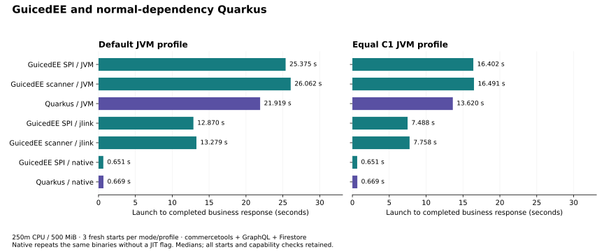
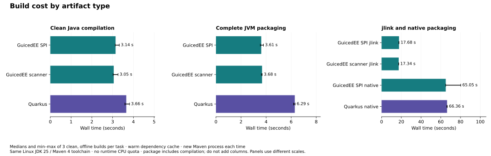

# GuicedEE benchmarks

A standalone benchmark suite for **GuicedEE 2.6.0**, comparing SPI and scanner discovery,
full-JDK and application-jlink execution, and native executables against normal Quarkus
applications. Both frameworks execute the same commercetools/GraphQL/Firestore business
workload, with REST, retries, timeouts, metrics, OpenAPI and Swagger capability checks.

## Performance

<!-- BEGIN GENERATED: headline -->
GuicedEE native completes the first full business request in **654 ms**, versus **678 ms** for Quarkus native (**3.6% less time**). Warm p50 is **5.96 / 5.85 ms** (GuicedEE / Quarkus). Peak charged memory is **68.77 / 55.04 MiB**; executables are **166.93 / 143.31 MiB**. The native sample contains **28 starts and 420 passing capability checks**.
<!-- END GENERATED: headline -->

<!-- BEGIN GENERATED: build-headline -->
**Clean JVM build:** GuicedEE SPI compiles in **3.31 s** versus **3.92 s** for Quarkus (**15.6% less time**). Complete runnable JVM packaging takes **3.89 / 6.68 s** (GuicedEE / Quarkus), **41.8% less time**. Medians of 3 clean, offline builds per task; dependency preparation is excluded.

**jlink versus native build:** GuicedEE SPI/scanner jlink packages in **18.11 / 17.95 s**, versus **69.77 s** for Quarkus native (**74.0% less time / 74.3% less time**).
<!-- END GENERATED: build-headline -->

**Median launch to completed business response, seconds.** JVM/default and C1 columns use
matched seven-mode Docker batches at **250m CPU / 500 MiB**. The native column uses a larger
counterbalanced native-only sample. Links open the full timing and memory grids.

<!-- BEGIN GENERATED: overview -->
| Application | Full JDK default (s) | Full JDK C1 (s) | Application jlink default (s) | Application jlink C1 (s) | Native (s) |
| --- | ---: | ---: | ---: | ---: | ---: |
| GuicedEE SPI | [26.533](RESULTS.md#jvm-default) | [16.769](RESULTS.md#jvm-c1) | [13.103](RESULTS.md#jvm-default) | [7.875](RESULTS.md#jvm-c1) | [0.654](RESULTS.md#native-standard) |
| GuicedEE scanner | [26.758](RESULTS.md#jvm-default) | [16.885](RESULTS.md#jvm-c1) | [13.844](RESULTS.md#jvm-default) | [7.975](RESULTS.md#jvm-c1) | SPI only |
| Quarkus / upstream SDKs | [21.882](RESULTS.md#jvm-default) | [14.138](RESULTS.md#jvm-c1) | Not implemented | Not implemented | [0.678](RESULTS.md#native-standard) |
<!-- END GENERATED: overview -->



[The full results](RESULTS.md) include readiness, first-request and full-business startup,
warm p50/p95/p99, memory, executable/image sizes, **percentage differences for every
GuicedEE mode**, and scanning/Guice/commercetools/Firestore phase analysis. Actual image IDs,
artifact hashes, flags and sample counts accompany the measurements. C1 applies equally to
all JVMs; native executables have no JIT tiering.

The [native inclusion audit](RESULTS.md#native-inclusion-and-allocation-audit) records the
provider and buffer-pool reductions, with a validated full-provider override. The separate
[1,000-request cohort](RESULTS.md#extended-native-request-sequence) shows memory after a longer
request sequence; its smaller cold-start sample is reported separately from the headline.

## Compile and package time

<!-- BEGIN GENERATED: build-grid -->
| Artifact | Clean compile (s) | Compile min–max (s) | Complete package (s) | Package min–max (s) | Build baseline | Package difference |
| --- | ---: | ---: | ---: | ---: | ---: | ---: |
| GuicedEE SPI / full JDK | 3.31 | 3.28–3.39 | 3.89 | 3.81–3.92 | Quarkus fast-JAR | -41.8% |
| GuicedEE scanner / full JDK | 3.28 | 3.21–3.33 | 3.81 | 3.77–3.89 | Quarkus fast-JAR | -43.0% |
| Quarkus upstream SDKs / fast-JAR | 3.92 | 3.69–4.02 | 6.68 | 6.54–6.85 | Quarkus fast-JAR | Baseline |
| GuicedEE SPI / application jlink | — | — | 18.11 | 18.11–18.20 | Quarkus native | -74.0% |
| GuicedEE scanner / application jlink | — | — | 17.95 | 17.90–18.01 | Quarkus native | -74.3% |
| GuicedEE SPI / native | — | — | 71.17 | 70.04–71.56 | Quarkus native | +2.0% |
| Quarkus upstream SDKs / native | — | — | 69.77 | 69.31–72.51 | Quarkus native | Baseline |
<!-- END GENERATED: build-grid -->



Complete packaging includes runtime dependencies for JVM artifacts, runtime creation for
jlink, and native compilation for native executables. **jlink and native build times compare
with Quarkus native**; full-JDK JVM builds compare with Quarkus fast-JAR. The chart also places
both jlink modes alongside GuicedEE native. A dash means that compilation is covered
by the underlying application, rather than timed again as a separate packaging project.
The build machine has its full CPU/memory allocation; runtime tests use the stated 250m/500 MiB
limits. [Build protocol, ranges and runtime tradeoffs](RESULTS.md#build-performance) and
[build CSV](docs/build-performance.csv) make those costs explicit.

## First-use SDK cost

<!-- BEGIN GENERATED: sdk-headline -->
**Commercetools first-use initialization:** GuicedEE SPI jlink records **0.996 s** versus **10.999 s** for standard Quarkus JVM: **10.003 s less** (**90.9% less time**). These are instrumented phase diagnostics (GuicedEE n=3, Quarkus n=3), separate from build time and the uninstrumented runtime rankings. The samples identify a first-use cost; they do not establish its cause or a general SDK performance ratio.
<!-- END GENERATED: sdk-headline -->

The [phase grid](RESULTS.md#first-use-business-phases) also includes scanner, wrapped-SDK
control and native diagnostics, plus REST/OAuth, GraphQL and Firestore completion.

## Run it

Install JDK 25, Maven 4, Python 3.11+, Node.js 22+ and Docker with Linux containers, then:

```shell
git -c core.longpaths=true clone --depth 1 https://github.com/GuicedEE/benchmarks.git
cd benchmarks
python tools/build.py --docker --runtime both --native
python tools/compare.py --docker --firebase --runtime both --native --runs 5 --requests 100 --warmup 20
# Repeat the same matrix with equal C1 tuning:
python tools/compare.py --docker --firebase --runtime both --native --tiered --runs 5 --requests 100 --warmup 20
# Measure clean compilation and packaging of all seven artifacts:
python tools/compare_builds.py --docker --runs 3
```

GuicedEE dependencies resolve through Maven. No DevSuite checkout, private framework path,
vendor account or production credentials are required. The build sets up the local Firestore
emulator; the runner starts the deterministic vendor fixture and enforces container limits.
See [RUNNING.md](RUNNING.md) for individual modes, configuration, explicit artifact repositories,
native metadata and diagnostics.

## Repository layout

| Path | Purpose |
|---|---|
| `guicedee`, `guicedee-scan` | Separate modular SPI and scanner applications |
| `guicedee-jlink`, `guicedee-scan-jlink`, `guicedee-native` | Linked-runtime and native packaging |
| `quarkus-standard` | Default Quarkus JVM/native comparison with upstream SDK dependencies |
| `common`, `quarkus`, `quarkus-native` | Shared workload, Quarkus adapter and optional wrapped-SDK control/build support |
| `fixtures`, `docker`, `tools` | Local services, image recipes, build/measurement/report tools |
| `results/latest` | Only the current published raw measurements and their manifest |
| `target/runs` | Ignored output of new executions |

[CSV](docs/current-performance.csv) and [JSON](docs/current-performance.json) expose the full
numeric grids. [Publishing results](results/README.md) replaces current measurements without
accumulating reports, source snapshots or experiment archives in the repository.

```shell
python -m unittest discover -s tools -p test_harness.py
python tools/verify_latest.py
python tools/render_performance.py --check
```

Measurements cover this local reference workload and its completed reactive flow. They are
sequential latency tests, not sustained-load throughput or production WAN measurements.
