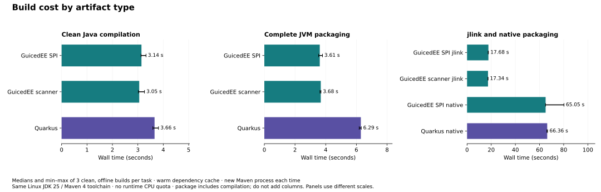
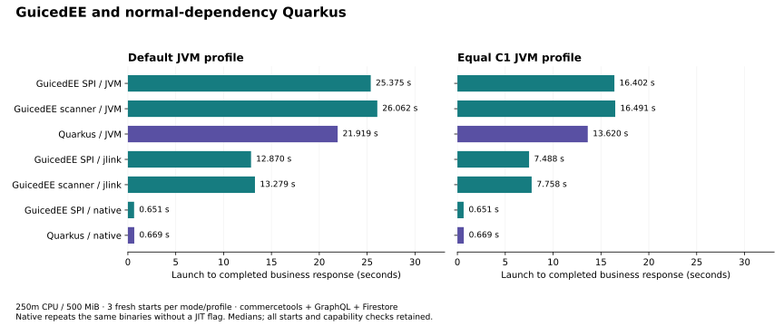
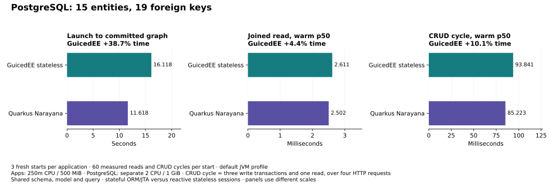

# Current performance state

**SDK measurements: 15 November 2026. Persistence measurements: 16 November 2026.**
Tables are generated from the current retained samples. Persistence and diagnostic
profiles have separate batch identities; instrumented timings do not enter the rankings.

<!-- BEGIN GENERATED: host-condition -->
The SDK runtime and clean-build comparisons were rerun after the host boot at **2026-11-15T17:49:08.5Z**. Across 7 retained host boundary samples, CPU utilization ranged **1.0–39.0%**, available physical memory **21.3–29.0 GiB**. Build, runtime and diagnostic stages ran sequentially. Host observations have partial coverage and are boundary snapshots, not continuous measurements of background load during each run. Available observations and their coverage are included in the latest measurement dataset. Boundary samples before the fresh three-framework runtime, persistence, diagnostic and clean-build sequence after the recorded host reboot; no continuous background-load monitoring. Other retained diagnostic profiles and the extended native workload have their separately recorded batch dates.
<!-- END GENERATED: host-condition -->

<!-- BEGIN GENERATED: headline -->
GuicedEE native completes the first full business request in **655 ms**, versus **681 ms** for Quarkus native (**3.9% less time**). Warm p50 is **4.93 / 5.19 ms** (GuicedEE / Quarkus). Peak charged memory is **68.57 / 55.30 MiB**; executables are **142.35 / 143.31 MiB**. Micronaut native completes the same first business response in **627 ms**, with warm p50 **5.25 ms**, peak charged memory **85.26 MiB** and a **205.94 MiB** executable. The native sample contains **18 starts and 270 passing capability checks**.
<!-- END GENERATED: headline -->

<!-- BEGIN GENERATED: runtime-findings -->
Micronaut native records the lower median full-business startup; GuicedEE native records the lower warm p50. Quarkus native has the lower peak container memory. The JVM grids separately report HTTP readiness and completion of the cold SDK/Firestore business request, so both startup costs remain visible.
<!-- END GENERATED: runtime-findings -->

## Build performance

<!-- BEGIN GENERATED: build-headline -->
**Clean JVM build:** GuicedEE SPI compiles in **3.52 s** versus **4.01 s** for Quarkus (**12.4% less time**). Complete runnable JVM packaging takes **4.10 / 6.80 s** (GuicedEE / Quarkus), **39.7% less time**. Medians of 3 clean, offline builds per task; dependency preparation is excluded.

**jlink versus native build:** GuicedEE SPI/scanner jlink packages in **18.25 / 17.88 s**, versus **70.91 s** for Quarkus native (**74.3% less time / 74.8% less time**).

**Micronaut:** compile **5.68 s**, JVM package **5.85 s**, native package **92.24 s**. GuicedEE SPI JVM packaging uses **30.0% less time**; SPI jlink uses **80.2% less time** than Micronaut native packaging.
<!-- END GENERATED: build-headline -->



<!-- BEGIN GENERATED: build-grid -->
| Artifact | Clean compile (s) | Compile min–max (s) | Complete package (s) | Package min–max (s) | Build baseline | Package difference |
| --- | ---: | ---: | ---: | ---: | ---: | ---: |
| GuicedEE SPI / full JDK | 3.52 | 3.47–3.91 | 4.10 | 3.92–4.19 | Quarkus fast-JAR | -39.7% |
| GuicedEE scanner / full JDK | 3.72 | 3.33–3.81 | 3.88 | 3.76–4.47 | Quarkus fast-JAR | -42.8% |
| Quarkus upstream SDKs / fast-JAR | 4.01 | 3.87–4.47 | 6.80 | 6.66–6.89 | Quarkus fast-JAR | Baseline |
| GuicedEE SPI / application jlink | — | — | 18.25 | 18.14–19.46 | Quarkus native | -74.3% |
| GuicedEE scanner / application jlink | — | — | 17.88 | 17.41–18.44 | Quarkus native | -74.8% |
| GuicedEE SPI / native | — | — | 67.86 | 66.25–86.94 | Quarkus native | -4.3% |
| Quarkus upstream SDKs / native | — | — | 70.91 | 68.84–85.88 | Quarkus native | Baseline |
| Micronaut upstream SDKs / JVM | 5.68 | 5.12–5.82 | 5.85 | 5.59–6.48 | Quarkus fast-JAR | -13.9% |
| Micronaut upstream SDKs / native | — | — | 92.24 | 84.91–95.63 | Quarkus native | +30.1% |
<!-- END GENERATED: build-grid -->

**Timing boundary:** wall time from launching a new Maven process to its successful exit.
`clean compile` measures the complete source-to-classes lifecycle, including Maven setup and
dependency resolution from disk. `clean package` measures a separate complete build from
clean outputs. The columns overlap; do not add them. JVM packaging includes dependency
copying for GuicedEE/Micronaut and fast-JAR augmentation for Quarkus. Micronaut's annotation
processing generates injection, serialization and OpenAPI metadata. Linked packaging creates and
archives the application runtime. Native packaging includes Java compilation, framework
preparation and the native compiler. These are build lifecycle timings, not isolated javac
CPU time, hot-reload latency or an incremental edit benchmark.

**Controlled inputs:** three repetitions per task, sequential rotated order, one untimed
successful package build per artifact to prepare dependencies. Every measured Maven
invocation is offline and cleans outputs; tests are skipped equally. All fourteen artifacts
use Maven 4.0.0-rc-7 and Mandrel JDK 25.0.5 in the same Linux container, with 32 logical CPUs
and approximately 31 GiB exposed by Docker, without the runtime benchmark's CPU/memory
limits. All native compilers use an 8 GiB Java heap. Image construction, artifact downloads,
SDK wrapper builds, metadata tracing and emulator preparation are excluded. The application
build consumes framework/vendor artifacts, as a developer build would.

Quarkus and Micronaut use their normal upstream dependencies and integrations. GuicedEE uses the prepared
framework artifacts with the hashes and artifact version recorded in
[build evidence](results/latest/builds.json). Source hashes, exact commands, Maven/JDK
versions, every elapsed sample and compiler completion evidence are retained there. The
dependency-cache inventory includes plugins and cached JARs; it is not a runtime module graph.
Build measurements form a separate cohort from the immutable images in the runtime grids.
The report verifies that the shared workload source hashes in those Docker images match
the build cohort before it renders the combined comparison.

### Native compiler memory

<!-- BEGIN GENERATED: build-memory -->
| Native compiler | Builds | Median peak RSS (GB) | Min–max (GB) |
| --- | ---: | ---: | ---: |
| GuicedEE SPI / native | 3 | 8.48 | 8.33–8.53 |
| Quarkus upstream SDKs / native | 3 | 8.07 | 8.04–8.30 |
| Micronaut upstream SDKs / native | 3 | 9.65 | 9.52–10.13 |
<!-- END GENERATED: build-memory -->

These are the compiler-reported peak RSS values from each timed native build, in the
compiler's decimal GB units and rounded log precision. They describe the native compiler
process, not the application at runtime or the combined Maven/container peak. All builders
use the same 8 GiB heap limit; RSS also includes memory outside that heap.

**Package differences:** negative means less time than the stated baseline. **jlink and native rows use
Quarkus native as the build-time baseline**; full-JDK JVM rows use Quarkus fast-JAR. The chart
compares both jlink modes with all three native builds. These are deployment build alternatives:
jlink includes a JVM runtime, while native compilation produces an ahead-of-time executable.
The runtime percentage grids retain their separately labelled JVM and native baselines.
Compilation for packaging-only projects is included in their total package time; a dash
indicates there is no separate compile-only measurement for that project.

### Build cost and resulting execution mode

<!-- BEGIN GENERATED: build-runtime -->
| Artifact | Complete package (s) | Full-business startup (s) | Warm p50 (ms) |
| --- | ---: | ---: | ---: |
| GuicedEE SPI / full JDK | 4.10 | 22.367 | 76.74 |
| GuicedEE scanner / full JDK | 3.88 | 23.862 | 82.87 |
| Quarkus upstream SDKs / fast-JAR | 6.80 | 23.320 | 38.33 |
| GuicedEE SPI / application jlink | 18.25 | 13.005 | 76.32 |
| GuicedEE scanner / application jlink | 17.88 | 13.195 | 74.42 |
| GuicedEE SPI / native | 67.86 | 0.655 | 4.93 |
| Quarkus upstream SDKs / native | 70.91 | 0.681 | 5.19 |
| Micronaut upstream SDKs / JVM | 5.85 | 26.573 | 75.39 |
| Micronaut upstream SDKs / native | 92.24 | 0.627 | 5.25 |
<!-- END GENERATED: build-runtime -->

<!-- BEGIN GENERATED: build-findings -->
GuicedEE's JVM package requires **39.7% less time** than Quarkus fast-JAR.

**jlink versus native:** SPI/scanner jlink take **18.25 / 17.88 s**. Against Quarkus native's **70.91 s**, that is **74.3% less time / 74.8% less time**; against GuicedEE native's **67.86 s**, it is **73.1% less time / 73.7% less time**.

The complete GuicedEE native build takes **67.86 s** versus **70.91 s**, or **4.3% less time**. jlink produces a bundled JVM runtime; native builds produce ahead-of-time executables. The runtime grid shows the startup and request-latency tradeoffs for each artifact.

Native build ranges overlap: **66.25–86.94 s** for GuicedEE and **68.84–85.88 s** for Quarkus. With 3 samples each, the median difference does not establish a consistent build-time lead.
<!-- END GENERATED: build-findings -->

Runtime columns use the default-JVM cohort and the larger native-only cohort, each under
250m CPU / 500 MiB. This table connects artifact choices to the measured runtime behavior;
builds and runtime samples are not paired observations. C1 changes launch flags, not the
artifact build, so its startup improvements do not incur a separate compilation cost.
The [C1 grid](#jvm-c1) retains its own runtime results.

## All execution modes

Values are median launch to completed business response in seconds. The default and C1
matrices measure the same six immutable JVM/jlink images. The primary native-only comparison
measures all three frameworks with rotated/reversed execution order. Full grids retain every start and measured request.



<!-- BEGIN GENERATED: overview -->
| Application | Full JDK default (s) | Full JDK C1 (s) | Application jlink default (s) | Application jlink C1 (s) | Native (s) |
| --- | ---: | ---: | ---: | ---: | ---: |
| GuicedEE SPI | [22.367](RESULTS.md#jvm-default) | [13.290](RESULTS.md#jvm-c1) | [13.005](RESULTS.md#jvm-default) | [8.300](RESULTS.md#jvm-c1) | [0.655](RESULTS.md#native-standard) |
| GuicedEE scanner | [23.862](RESULTS.md#jvm-default) | [13.480](RESULTS.md#jvm-c1) | [13.195](RESULTS.md#jvm-default) | [7.777](RESULTS.md#jvm-c1) | SPI only |
| GuicedEE CDI SPI | Not measured | Not measured | Not measured | Not measured | Not measured |
| GuicedEE CDI scanner | Not measured | Not measured | Not measured | Not measured | SPI only |
| Quarkus / upstream SDKs | [23.320](RESULTS.md#jvm-default) | [14.177](RESULTS.md#jvm-c1) | Not implemented | Not implemented | [0.681](RESULTS.md#native-standard) |
| Micronaut / upstream SDKs | [26.573](RESULTS.md#jvm-default) | [15.658](RESULTS.md#jvm-c1) | Not implemented | Not implemented | [0.627](RESULTS.md#native-standard) |
<!-- END GENERATED: overview -->

Read the [native comparison](#native-standard), [default JVM matrix](#jvm-default),
[C1 matrix](#jvm-c1), [percentage differences](#relative-differences),
[packaging](#packaging), and [phase diagnostics](#phase-diagnostics).

## Measurement contract

| Measurement | Boundary and interpretation |
|---|---|
| HTTP ready | External launch through an HTTP 200 with exactly `{"ready":true}` from `/ready`; fixed response, not dependency health. Polled every 50 ms. |
| First request | Client elapsed time for the first complete `POST /quote?persist=true` response, including JSON parsing. |
| Full business | External launch through that complete, validated business response. Includes commercetools OAuth/REST/GraphQL and Firestore write/read completion. |
| First OpenAPI | First documentation fetch after business and earlier capability checks; not a documentation-first startup test. |
| Warm p50/p95/p99 | Median of each start's recorded percentile after explicit warmup; one outstanding request. Not pooled percentiles, concurrency or throughput. |
| Peak/end memory | Cgroup `memory.peak` / `memory.current` at the end of the run; whole-container charged memory including cache, not RSS or heap. |
| Docker image size | Recorded daemon-local image-store accounting; includes shared layers and, on this containerd store, compressed content and unpacked snapshots. Not registry transfer size. |

Docker groups use **0.25 CPU, 500 MiB memory and no additional swap**. Every process receives
`-Xms128m -Xmx384m -XX:ActiveProcessorCount=2`. C1 adds `-XX:TieredStopAtLevel=1` to every JVM
in that group; native executables receive no JIT flag. JVM images use Oracle JDK 25;
native uses Mandrel 25.0.5, O2, Serial GC and x86-64-v3, without PGO or UPX.

Timing begins before `docker run`, so local container creation is included. Building and
pulling images is excluded. Fixtures and the Firestore emulator are already running outside
the application quota. Host page caches are not flushed. All starts and outliers are kept;
launch order rotates/reverses. Independently calculated medians need not add up.

Only complete eligible, uninstrumented batches enter performance tables. Full-body business
validation, all 15 capability checks and all measured requests must pass. Failed executions remain in local run output and cannot enter the published comparison. All image identities appear in the [identity grid](#image-identities).

<a id="native-standard"></a>
## Native: normal Quarkus dependencies

This is the primary application comparison: GuicedEE SPI native, Micronaut Platform 5.2.6 and Quarkus with upstream
commercetools 20.4.0, Firebase Admin 9.12.0, Quarkus 3.40.1 and Quarkiverse Firebase/Firestore
2.25.1. Quarkus has no GuicedEE SDK wrappers or framework patches. Native compatibility
metadata and application configuration are described in [the project](quarkus-standard/README.md).
Micronaut uses its own native support and the same upstream SDK versions; see its
[application and metadata contract](micronaut/README.md). Business sources match;
dependency packaging and transitive graphs deliberately differ.

The runner rotates and reverses framework order across fresh starts, using fixed image IDs and equal flags.

<!-- BEGIN GENERATED: native-standard -->
Displayed rows: **18 starts / 270 passing checks / 540 successful measured requests**. Each start: 10 warmups, 30 measured requests. Batch IDs in [latest measurements](results/latest/measurements.json): `20261115-202557`.

| Variant | Starts | Ready (s) | First request (ms) | Full business (s) | Full business min–max (s) | First OpenAPI (ms) |
| --- | ---: | ---: | ---: | ---: | ---: | ---: |
| GuicedEE SPI / native | 6 | 0.572 | 79.27 | 0.655 | 0.620–0.980 | 3.15 |
| Quarkus upstream SDKs / native | 6 | 0.579 | 101.72 | 0.681 | 0.661–0.725 | 1.98 |
| Micronaut upstream SDKs / native | 6 | 0.573 | 54.48 | 0.627 | 0.607–0.665 | 2.53 |

| Variant | Warm p50 (ms) | Warm p95 (ms) | Warm p99 (ms) | Peak memory median (MiB) | Peak memory min–max (MiB) | End memory median (MiB) |
| --- | ---: | ---: | ---: | ---: | ---: | ---: |
| GuicedEE SPI / native | 4.93 | 28.03 | 30.25 | 68.57 | 68.06–68.93 | 64.98 |
| Quarkus upstream SDKs / native | 5.19 | 28.27 | 33.65 | 55.30 | 55.07–55.62 | 52.10 |
| Micronaut upstream SDKs / native | 5.25 | 27.60 | 30.86 | 85.26 | 84.41–85.77 | 81.86 |
<!-- END GENERATED: native-standard -->

<!-- BEGIN GENERATED: native-deltas -->
| Metric | GuicedEE native | Quarkus native | GuicedEE vs Quarkus | Micronaut native | GuicedEE vs Micronaut |
| --- | ---: | ---: | ---: | ---: | ---: |
| Full-business startup | 654.68 ms | 681.35 ms | -3.9% | 626.83 ms | +4.4% |
| First business request | 79.27 ms | 101.72 ms | -22.1% | 54.48 ms | +45.5% |
| Warm p50 | 4.93 ms | 5.19 ms | -5.0% | 5.25 ms | -6.0% |
| Warm p95 | 28.03 ms | 28.27 ms | -0.9% | 27.60 ms | +1.6% |
| Warm p99 | 30.25 ms | 33.65 ms | -10.1% | 30.86 ms | -2.0% |
| Peak container memory | 68.57 MiB | 55.30 MiB | +24.0% | 85.26 MiB | -19.6% |
| Executable size | 142.35 MiB | 143.31 MiB | -0.7% | 205.94 MiB | -30.9% |
| Docker local image size | 357.23 MiB | 353.04 MiB | +1.2% | 437.83 MiB | -18.4% |
<!-- END GENERATED: native-deltas -->

Negative differences mean GuicedEE uses less time or space. Readiness polling is 50 ms,
so small readiness differences are not precise internal startup measurements. Warm p95/p99
are medians of per-start percentiles; these sequential samples do not establish sustained
throughput. First-use outliers remain included. The [native grid](#native-standard) makes
the startup/latency and memory/size tradeoff explicit.

### Extended native request sequence

This separate cohort uses the same native images, heap settings and container limits,
with **1,000 measured requests per start**. It checks behavior beyond the shorter primary
sample. Requests remain sequential; this is not a concurrent throughput or soak benchmark.

<!-- BEGIN GENERATED: native-extended -->
Displayed rows: **6 starts / 90 passing checks / 6000 successful measured requests**. Each start: 20 warmups, 1000 measured requests. Batch IDs in [latest measurements](results/latest/measurements.json): `20261115-125042`.

| Variant | Starts | Ready (s) | First request (ms) | Full business (s) | Full business min–max (s) | First OpenAPI (ms) |
| --- | ---: | ---: | ---: | ---: | ---: | ---: |
| GuicedEE SPI / native | 3 | 0.578 | 92.65 | 0.669 | 0.651–0.944 | 3.34 |
| Quarkus upstream SDKs / native | 3 | 0.586 | 125.92 | 0.712 | 0.701–0.717 | 2.13 |

| Variant | Warm p50 (ms) | Warm p95 (ms) | Warm p99 (ms) | Peak memory median (MiB) | Peak memory min–max (MiB) | End memory median (MiB) |
| --- | ---: | ---: | ---: | ---: | ---: | ---: |
| GuicedEE SPI / native | 4.07 | 28.01 | 40.42 | 78.88 | 77.14–118.12 | 75.04 |
| Quarkus upstream SDKs / native | 4.12 | 27.73 | 41.72 | 80.09 | 79.62–81.73 | 76.65 |
<!-- END GENERATED: native-extended -->

<!-- BEGIN GENERATED: extended-findings -->
In this separate 3-start-per-framework cohort, median peak charged memory is **78.88 / 80.09 MiB** (GuicedEE / Quarkus), a GuicedEE difference of **-1.5%**. Its full-business startup medians are **669 / 712 ms**. Keep this smaller startup sample separate from the primary counterbalanced comparison; longer request sequences also change allocation and GC behavior.
<!-- END GENERATED: extended-findings -->

### Native inclusion and allocation profile

The current application excludes 15 unused xDS, RLS, legacy grpclb and Google C2P service
providers from native compilation. DNS, ordinary load balancing, transports and TLS
providers remain registered. SDK JARs and JPMS descriptors are preserved. The optional
control-plane providers can be restored with `--include-cloud-control-plane`.

The Linux x86-64 recipe excludes native-library resources for Windows, macOS and ARM,
while retaining Linux x86-64 Conscrypt, gRPC TLS and epoll libraries.

Class-query-only commercetools model metadata is conditional on the model being reachable.
Retained models keep member queries and annotations; actual traced invocation entries remain.
Protobuf accessors keep reflection invocation support, while static parsing convenience overloads
remain callable directly without becoming reflection roots. `--full-sdk-reflection` restores the
original traced model/protobuf metadata. This policy covers the verified workload; additional
SDK operations still require their own native trace and capability checks.

The application's native SPI sets pooled Netty allocators to 64 KiB chunks, including the
relocated SDK copies with their own property names. Runtime `-D` overrides are supported.
These are application defaults; the normal Quarkus implementation is unchanged. Both
native compilers still use O2, Serial GC, x86-64-v3 and an 8 GiB builder heap.
[Configuration and overrides](guicedee-native/README.md) describe the scope.

<!-- BEGIN GENERATED: native-profile -->
| Metric | Current GuicedEE native artifact |
| --- | ---: |
| Reachable types | 33,493 |
| Methods registered for reflection | 53,073 |
| Reachable methods | 172,953 |
| Compiled code area | 67.41 MiB |
| Embedded resources | 281 |
| Image heap | 74.56 MiB |
| Artifact compiler peak RSS | 7969.84 MiB |

Compiler counts and peak RSS describe the single build that produced the currently measured executable. Repeated clean-build time and compiler memory are measured separately in the build grid. [Current compiler profile](results/latest/native-profile.json).
<!-- END GENERATED: native-profile -->

The retained compiler breakdown identifies `java.base`, Firebase and commercetools as the
largest remaining code origins. XML, Jackson, Log4j, OpenAPI and HTTP/Vert.x code also remain.
These are candidates for more targeted reachability work, not evidence that their whole
modules can be removed. Reflection metadata and SDK model types still contribute to the
image heap. The [compiler profile](results/latest/native-profile.json) retains the compiler's
top code origins and heap object types alongside its counts.

The headline memory figures are **peak charged container memory**, not process RSS. The
harness reads executable files to verify identity before launching each process, so these
are process starts with a warm filesystem cache. Separate end-of-run RSS/PSS snapshots
below come from the instrumented native phase captures. They include resident file mappings
and diagnostic overhead and must not be substituted for the uninstrumented peak figures.

<!-- BEGIN GENERATED: native-memory -->
| Instrumented native process | Starts | End RSS (MiB) | End PSS (MiB) | Anonymous PSS (MiB) | File-backed PSS (MiB) |
| --- | ---: | ---: | ---: | ---: | ---: |
| GuicedEE native | 3 | 160.59 | 159.86 | 59.57 | 100.28 |
| Quarkus upstream native | 3 | 129.89 | 129.17 | 42.46 | 86.71 |
| Micronaut upstream native | 1 | 188.12 | 187.39 | 74.56 | 112.84 |
<!-- END GENERATED: native-memory -->

<a id="jvm-default"></a>
<a id="current-linux-native-comparison"></a>
## Full matched matrix: default JVMs

The full-JDK, application-jlink and native modes use **normal-dependency Quarkus** as the
baseline. Every image passes the same business and capability checks. The native rows
show the alternative compilation strategy within this matched batch.

<!-- BEGIN GENERATED: jvm-default -->
Displayed rows: **18 starts / 270 passing checks / 1800 successful measured requests**. Each start: 20 warmups, 100 measured requests. Batch IDs in [latest measurements](results/latest/measurements.json): `20261115-200219`.

| Variant | Starts | Ready (s) | First request (ms) | Full business (s) | Full business min–max (s) | First OpenAPI (ms) |
| --- | ---: | ---: | ---: | ---: | ---: | ---: |
| GuicedEE SPI / full JDK | 3 | 9.977 | 12,389.78 | 22.367 | 22.231–23.777 | 186.19 |
| GuicedEE scanner / full JDK | 3 | 10.774 | 12,896.85 | 23.862 | 22.853–24.538 | 104.10 |
| Quarkus upstream SDKs / fast-JAR | 3 | 6.319 | 16,700.57 | 23.320 | 21.960–23.388 | 493.00 |
| Micronaut upstream SDKs / JVM | 3 | 8.872 | 17,901.20 | 26.573 | 26.089–26.938 | 191.88 |
| GuicedEE SPI / application jlink | 3 | 8.102 | 4,902.45 | 13.005 | 12.027–13.165 | 101.89 |
| GuicedEE scanner / application jlink | 3 | 8.222 | 4,697.18 | 13.195 | 12.827–13.280 | 97.53 |

| Variant | Warm p50 (ms) | Warm p95 (ms) | Warm p99 (ms) | Peak memory median (MiB) | Peak memory min–max (MiB) | End memory median (MiB) |
| --- | ---: | ---: | ---: | ---: | ---: | ---: |
| GuicedEE SPI / full JDK | 76.74 | 97.30 | 99.63 | 313.46 | 304.61–368.54 | 310.08 |
| GuicedEE scanner / full JDK | 82.87 | 100.16 | 109.49 | 309.30 | 300.99–379.31 | 305.59 |
| Quarkus upstream SDKs / fast-JAR | 38.33 | 95.38 | 99.60 | 278.00 | 275.73–352.39 | 272.01 |
| Micronaut upstream SDKs / JVM | 75.39 | 100.43 | 192.72 | 305.62 | 299.90–369.29 | 302.39 |
| GuicedEE SPI / application jlink | 76.32 | 98.03 | 99.59 | 231.16 | 225.23–243.55 | 227.18 |
| GuicedEE scanner / application jlink | 74.42 | 98.52 | 101.76 | 229.09 | 227.24–231.46 | 224.75 |
<!-- END GENERATED: jvm-default -->

<a id="jvm-c1"></a>
## Full matched matrix: equal C1 JVM tuning

These are the **same immutable images** as the default matrix, with C1 applied equally to
all JVMs. Quarkus native is repeated as a batch reference using the same binary and no JIT flag.

<!-- BEGIN GENERATED: jvm-c1 -->
Displayed rows: **18 starts / 270 passing checks / 1800 successful measured requests**. Each start: 20 warmups, 100 measured requests. Batch IDs in [latest measurements](results/latest/measurements.json): `20261115-201129`.

| Variant | Starts | Ready (s) | First request (ms) | Full business (s) | Full business min–max (s) | First OpenAPI (ms) |
| --- | ---: | ---: | ---: | ---: | ---: | ---: |
| GuicedEE SPI / full JDK | 3 | 6.148 | 7,106.86 | 13.290 | 13.051–13.315 | 41.37 |
| GuicedEE scanner / full JDK | 3 | 6.273 | 7,207.28 | 13.480 | 12.923–13.852 | 15.65 |
| Quarkus upstream SDKs / fast-JAR | 3 | 4.059 | 10,206.56 | 14.177 | 13.869–14.787 | 292.61 |
| Micronaut upstream SDKs / JVM | 3 | 5.050 | 10,720.66 | 15.658 | 15.651–16.115 | 89.05 |
| GuicedEE SPI / application jlink | 3 | 5.517 | 2,658.38 | 8.300 | 7.263–8.401 | 85.89 |
| GuicedEE scanner / application jlink | 3 | 5.186 | 2,591.04 | 7.777 | 7.504–7.928 | 83.14 |

| Variant | Warm p50 (ms) | Warm p95 (ms) | Warm p99 (ms) | Peak memory median (MiB) | Peak memory min–max (MiB) | End memory median (MiB) |
| --- | ---: | ---: | ---: | ---: | ---: | ---: |
| GuicedEE SPI / full JDK | 11.70 | 89.50 | 91.32 | 261.80 | 259.95–262.21 | 258.38 |
| GuicedEE scanner / full JDK | 10.42 | 87.12 | 90.74 | 264.52 | 263.69–264.71 | 260.66 |
| Quarkus upstream SDKs / fast-JAR | 10.21 | 86.70 | 90.10 | 242.61 | 242.43–242.65 | 239.24 |
| Micronaut upstream SDKs / JVM | 9.30 | 88.21 | 90.09 | 258.56 | 258.24–259.45 | 255.38 |
| GuicedEE SPI / application jlink | 10.42 | 89.03 | 91.90 | 190.82 | 189.64–191.58 | 187.70 |
| GuicedEE scanner / application jlink | 9.60 | 89.44 | 92.58 | 194.20 | 193.20–195.79 | 190.44 |
<!-- END GENERATED: jvm-c1 -->

<a id="relative-differences"></a>
## Percentage differences against Quarkus and Micronaut

Each row uses its named baseline in the **same batch and tuning profile**. JVM and
jlink rows compare against the normal Quarkus and Micronaut JVM applications; native
differences appear in the native grid. Negative
values mean less time or memory, positive values mean more. No cross-profile ranking is
implied. The byte sizes are compared separately below.

<!-- BEGIN GENERATED: relative -->
| Profile | Application mode | Baseline | Ready | Full business | Warm p50 | Warm p95 | Peak memory |
| --- | ---: | ---: | ---: | ---: | ---: | ---: | ---: |
| jvm-default | GuicedEE SPI / full JDK | Quarkus upstream SDKs / fast-JAR | +57.9% | -4.1% | +100.2% | +2.0% | +12.8% |
| jvm-default | GuicedEE SPI / full JDK | Micronaut upstream SDKs / JVM | +12.5% | -15.8% | +1.8% | -3.1% | +2.6% |
| jvm-default | GuicedEE scanner / full JDK | Quarkus upstream SDKs / fast-JAR | +70.5% | +2.3% | +116.2% | +5.0% | +11.3% |
| jvm-default | GuicedEE scanner / full JDK | Micronaut upstream SDKs / JVM | +21.4% | -10.2% | +9.9% | -0.3% | +1.2% |
| jvm-default | Micronaut upstream SDKs / JVM | Quarkus upstream SDKs / fast-JAR | +40.4% | +13.9% | +96.7% | +5.3% | +9.9% |
| jvm-default | GuicedEE SPI / application jlink | Quarkus upstream SDKs / fast-JAR | +28.2% | -44.2% | +99.1% | +2.8% | -16.8% |
| jvm-default | GuicedEE SPI / application jlink | Micronaut upstream SDKs / JVM | -8.7% | -51.1% | +1.2% | -2.4% | -24.4% |
| jvm-default | GuicedEE scanner / application jlink | Quarkus upstream SDKs / fast-JAR | +30.1% | -43.4% | +94.1% | +3.3% | -17.6% |
| jvm-default | GuicedEE scanner / application jlink | Micronaut upstream SDKs / JVM | -7.3% | -50.3% | -1.3% | -1.9% | -25.0% |
| jvm-c1 | GuicedEE SPI / full JDK | Quarkus upstream SDKs / fast-JAR | +51.5% | -6.3% | +14.5% | +3.2% | +7.9% |
| jvm-c1 | GuicedEE SPI / full JDK | Micronaut upstream SDKs / JVM | +21.7% | -15.1% | +25.7% | +1.5% | +1.3% |
| jvm-c1 | GuicedEE scanner / full JDK | Quarkus upstream SDKs / fast-JAR | +54.5% | -4.9% | +2.0% | +0.5% | +9.0% |
| jvm-c1 | GuicedEE scanner / full JDK | Micronaut upstream SDKs / JVM | +24.2% | -13.9% | +12.0% | -1.2% | +2.3% |
| jvm-c1 | Micronaut upstream SDKs / JVM | Quarkus upstream SDKs / fast-JAR | +24.4% | +10.4% | -8.9% | +1.7% | +6.6% |
| jvm-c1 | GuicedEE SPI / application jlink | Quarkus upstream SDKs / fast-JAR | +35.9% | -41.5% | +2.0% | +2.7% | -21.3% |
| jvm-c1 | GuicedEE SPI / application jlink | Micronaut upstream SDKs / JVM | +9.3% | -47.0% | +12.0% | +0.9% | -26.2% |
| jvm-c1 | GuicedEE scanner / application jlink | Quarkus upstream SDKs / fast-JAR | +27.8% | -45.1% | -6.0% | +3.2% | -20.0% |
| jvm-c1 | GuicedEE scanner / application jlink | Micronaut upstream SDKs / JVM | +2.7% | -50.3% | +3.2% | +1.4% | -24.9% |
<!-- END GENERATED: relative -->

<!-- BEGIN GENERATED: findings -->
**Default JVM:** full-JDK SPI/scanner complete the first business response in **22.367/23.862 s**, versus **23.320 s** for Quarkus JVM. SPI uses **4.1% less time**. Micronaut JVM completes in **26.573 s**; SPI uses **15.8% less time** against it. Use the retained ranges to judge the median difference; each mode has three starts.

**Default JVM, linked workload:** linked SPI/scanner complete the first business response in **13.005/13.195 s**, versus **23.320 s** for Quarkus JVM. SPI jlink uses **44.2% less time** for this workload. The SDK scanner reports zero linked-image URLs, so this is not evidence of equivalent complete SDK model discovery.

**C1 JVM:** full-JDK SPI/scanner complete the first business response in **13.290/13.480 s**, versus **14.177 s** for Quarkus JVM. SPI uses **6.3% less time**. Micronaut JVM completes in **15.658 s**; SPI uses **15.1% less time** against it. Use the retained ranges to judge the median difference; each mode has three starts.

**C1 JVM, linked workload:** linked SPI/scanner complete the first business response in **8.300/7.777 s**, versus **14.177 s** for Quarkus JVM. SPI jlink uses **41.5% less time** for this workload. The SDK scanner reports zero linked-image URLs, so this is not evidence of equivalent complete SDK model discovery.
<!-- END GENERATED: findings -->

<a id="packaging"></a>
## Packaging and module footprint

Image sizes below cover each measured binary once. Runtime memory is in the performance
grids above; it is not the same quantity as disk size.

<!-- BEGIN GENERATED: packaging -->
| Variant | Evidence group | Docker local image (MiB) | Executable (MiB) | Image ID prefix |
| --- | ---: | ---: | ---: | ---: |
| GuicedEE SPI / native | native-standard | 357.23 | 142.35 | `cba41d26ee56` |
| Quarkus upstream SDKs / native | native-standard | 353.04 | 143.31 | `32153f649fea` |
| Micronaut upstream SDKs / native | native-standard | 437.83 | 205.94 | `a673984bc13a` |
| GuicedEE SPI / full JDK | jvm-default | 1,027.28 | — | `81dc069a9833` |
| GuicedEE scanner / full JDK | jvm-default | 1,027.27 | — | `b08deee9eafc` |
| Quarkus upstream SDKs / fast-JAR | jvm-default | 976.77 | — | `ff1c796950c8` |
| Micronaut upstream SDKs / JVM | jvm-default | 964.41 | — | `6418eba79491` |
| GuicedEE SPI / application jlink | jvm-default | 498.16 | — | `328a1e99248b` |
| GuicedEE scanner / application jlink | jvm-default | 498.16 | — | `c394e88f4118` |
<!-- END GENERATED: packaging -->

The linked-runtime audit applies specifically to the images in the full JVM matrix:

<!-- BEGIN GENERATED: jlink-size -->
| Measured jlink payload | SPI | Scanner |
| --- | ---: | ---: |
| Runtime including application (MiB) | 180.78 | 180.77 |
| Module image (MiB) | 147.11 | 147.11 |
| Unpacked Docker layers (MiB) | 299.51 | 299.51 |
| Installed modules | 124 | 124 |
| Mandatory module closure | 112 | 112 |
| Closure including installed service providers | 117 | 117 |
<!-- END GENERATED: jlink-size -->

The roughly 498 MiB Docker-store value contains a **181 MiB linked application runtime**.
The graph is valid but not minimal: 124 installed modules versus 112 in the mandatory closure
and 117 when resolving providers already present. The current dataset retains the application roots, installed module names and both closure
sets. Linking includes whole modules and their resources; successful linking does not prove
that every class is exercised by the workload. Closure differences are investigation targets,
not demonstrated savings from deleting those modules.

<a id="phase-diagnostics"></a>
## Startup and reactive-flow phase diagnostics

These instrumented runs explain where time is spent. **They are excluded from the ranked
performance grids.** The columns below come from separate diagnostic batches, with three
starts per variant. They provide coverage and hypotheses, not a matched phase-level framework
ranking. Missing phases mean unmeasured,
not zero cost.

<!-- BEGIN GENERATED: phase-sources -->
| Diagnostic variant | Starts | Evidence | Image ID prefix |
| --- | ---: | ---: | ---: |
| Scanner JVM | 1 | `20261115-140817` | `b08deee9eafc` |
| SPI JVM | 1 | `20261115-140817` | `81dc069a9833` |
| SPI jlink | 1 | `20261115-140817` | `328a1e99248b` |
| Scanner jlink | 1 | `20261115-140817` | `c394e88f4118` |
| Quarkus upstream JVM | 1 | `20261115-140817` | `ff1c796950c8` |
| GuicedEE native | 3 | `20261115-125151` | `cba41d26ee56` |
| Quarkus upstream native | 3 | `20261115-125151` | `32153f649fea` |
| Micronaut upstream JVM | 1 | `20261115-203340` | `6418eba79491` |
| Micronaut upstream native | 1 | `20261115-203340` | `a673984bc13a` |
<!-- END GENERATED: phase-sources -->

### Framework startup phases

<!-- BEGIN GENERATED: phase-startup -->
| Inclusive phase (ms) | SPI JVM | Scanner JVM | SPI jlink | Scanner jlink | GuicedEE native |
| --- | ---: | ---: | ---: | ---: | ---: |
| Context discovery | 889.69 | 510.58 | 602.26 | 596.62 | 4.60 |
| Discovery | 0.32 | 594.50 | 0.37 | 500.93 | 0.00 |
| ClassGraph scan | — | 398.11 | — | 397.85 | — |
| Pre-startup hooks | 1,304.09 | 705.12 | 1,098.52 | 812.70 | 4.51 |
| Guice module discovery | 698.48 | 402.60 | 403.66 | 493.46 | 0.88 |
| Guice injector creation | 2,093.55 | 1,792.94 | 1,704.25 | 1,795.82 | 17.14 |
| OpenAPI provider (within injector) | 1,198.38 | 1,094.22 | 998.91 | 1,089.73 | 5.02 |
| Post-startup hooks | 1,496.76 | 994.11 | 897.30 | 1,100.48 | 92.42 |
<!-- END GENERATED: phase-startup -->

Phases are inclusive wall time, with nested work, class loading, CPU throttling and scheduling.
Do not add columns or subtract internal timings from external startup timers. Quarkus internal
framework startup has no equivalent capture in this harness.

In the linked captures, SPI performs no ClassGraph scan. Scanner mode accepts **three classes
and seven resources**, all in `bench.guicedee.scan`. Both report **35 startup Guice bindings**,
19 explicit and 16 created on demand. SDK internals and lazy bindings are not represented by
that startup snapshot. The native diagnostic uses the same immutable executable as the
headline native comparison, with instrumentation enabled for the phase capture.

### First-use business phases

<!-- BEGIN GENERATED: sdk-headline -->
**Commercetools first-use initialization:** GuicedEE SPI JVM records **13.995 s** versus **11.503 s** for standard Quarkus JVM: **2.492 s more** (**21.7% more time**). These are instrumented phase diagnostics (GuicedEE n=1, Quarkus n=1), separate from build time and the uninstrumented runtime rankings. The samples identify a first-use cost; they do not establish a general SDK performance ratio. The linked-image SDK scanner reports zero URLs; jlink timings cover the tested workload, not complete SDK mixin/subtype discovery.
<!-- END GENERATED: sdk-headline -->

<!-- BEGIN GENERATED: phase-workload -->
| Inclusive phase (ms) | Scanner JVM | SPI JVM | SPI jlink | Scanner jlink | Quarkus upstream JVM | GuicedEE native | Quarkus upstream native | Micronaut upstream JVM | Micronaut upstream native |
| --- | ---: | ---: | ---: | ---: | ---: | ---: | ---: | ---: | ---: |
| JDK HTTP client construction | 1,600.31 | 2,798.89 | 1,194.39 | 1,005.29 | 708.12 | 0.35 | 0.60 | 795.03 | 0.40 |
| Commercetools client initialization | 9,105.06 | 13,995.06 | 499.97 | 509.15 | 11,502.78 | 42.15 | 38.85 | 12,618.33 | 3.23 |
| Commercetools REST + first OAuth | 897.15 | 1,093.52 | 999.97 | 993.26 | 1,303.63 | 8.17 | 10.54 | 1,289.14 | 10.27 |
| GraphQL completion | 194.85 | 102.10 | 99.40 | 199.05 | 199.99 | 1.43 | 2.15 | 293.52 | 2.08 |
| Firestore client initialization | 1,414.18 | 1,804.74 | 1,613.67 | 1,697.33 | 1,498.43 | 4.95 | 31.35 | 1,210.32 | 39.29 |
| Firestore write completion | 1,110.47 | 2,062.01 | 1,699.96 | 1,297.93 | 814.49 | 9.97 | 8.01 | 1,366.95 | 11.31 |
| Firestore read completion | 8.70 | 38.52 | 10.46 | 8.37 | 86.12 | 1.33 | 1.39 | 14.86 | 2.34 |
<!-- END GENERATED: phase-workload -->

The commercetools initialization phase is distinct from the first REST/OAuth request.
Each column uses the sample counts shown in the diagnostic source table. The data locates
cold SDK cost but does not isolate class loading, JIT compilation or another initializer
as its entire cause. The SDK constructs two identical Reflections scans during mapper
creation; the current JVM wrapper shares their index only for that construction.
Instrumented phase durations remain separate from the runtime rankings.

<a id="jvm-discovery-boundaries"></a>
### JVM discovery and measurement boundaries

The current JVM artifacts use the packaged Commercetools wrapper with scoped scan reuse
and its current external dependency graph. Named-module smoke checks discover all four SDK
mixins and 2,047 annotated SDK subtypes, plus application-defined extensions. Unit checks
compare discovery with the original scanner and cover mapper options, independent scans,
nested scopes, context class loaders and cleanup after provider failure.

The GuicedEE JVM images and native/build inputs retain separately identified dependency
graphs. Shared workload sources are unchanged. Clean builds are freshly measured using
the staged native-compatible artifacts; the JVM scan-reuse wrapper remains a distinct
artifact input. The build/runtime tradeoff table identifies those inputs, rather than
implying the JVM wrapper has been rebuilt as native.

In the linked images, the SDK's Reflections scanner reports **zero scan URLs**. The complete
benchmark workload passes, but those runs do not establish full SDK mixin/subtype discovery
from `jrt:/`. The jlink SDK initialization gap must not be presented as an equivalent full
model-discovery speedup. This is separate from GuicedEE's own application discovery checks.

SDK spans wait for completion of the asynchronous operations. The shared Firestore adapter
currently waits on SDK futures inside `CompletableFuture.supplyAsync`; both applications
wait for it, so the work is timed, although that adapter is not fully nonblocking. The HTTP
client construction phase sums repeated constructions within each start before taking its
median. Quarkus CDI proxy/subclass construction can initialize the workload twice; a second
construction is retained in the capture rather than counted as a second business operation.

<a id="postgresql-persistence"></a>
## PostgreSQL persistence

This separate workload uses 15 related entities and 19 foreign keys, with the same graph
and query in all three applications. Readiness includes the database lifecycle; the first business
response includes the committed graph. The graph precedes the detailed measurements below.

<!-- BEGIN GENERATED: persistence -->
Measured **2026-11-16**, **default JVM profile**, batch `20261116-133334`. **9 fresh starts / 126 passing checks**. Each start has 20 warmup reads and CRUD cycles, then 150 measured reads and 150 measured CRUD cycles. All samples are retained.



| Application | Starts | DB-ready (s) | First transaction (ms) | Launch to committed graph (s) | Full startup min–max (s) | Peak charged memory (MiB) | Hibernate ORM |
| --- | ---: | ---: | ---: | ---: | ---: | ---: | ---: |
| GuicedEE reactive stateless | 3 | 12.687 | 2498.04 | 15.025 | 14.599–15.229 | 228.58 | 7.4.15.Final |
| Quarkus ORM / Narayana | 3 | 10.068 | 1810.11 | 12.180 | 11.632–12.224 | 222.59 | 7.4.9.Final |
| Micronaut ORM / local transactions | 3 | 14.893 | 1901.60 | 16.794 | 15.803–16.978 | 242.57 | 7.4.10.Final |

| Operation | GuicedEE p50 (ms) | p95 | p99 | Quarkus p50 (ms) | p95 | p99 | Micronaut p50 (ms) | p95 | p99 | GuicedEE vs Quarkus | GuicedEE vs Micronaut |
| --- | ---: | ---: | ---: | ---: | ---: | ---: | ---: | ---: | ---: | ---: | ---: |
| Joined graph read | 2.41 | 69.32 | 90.72 | 2.31 | 62.66 | 84.68 | 2.46 | 79.00 | 88.00 | +4.7% | -1.7% |
| Create 15 rows | 5.52 | 87.82 | 98.32 | 5.68 | 86.30 | 94.36 | 7.01 | 89.88 | 97.67 | -2.8% | -21.2% |
| Update 15 rows | 6.67 | 91.71 | 99.22 | 6.15 | 88.04 | 97.47 | 8.34 | 93.99 | 100.49 | +8.5% | -20.0% |
| Delete 15 rows | 5.74 | 90.07 | 98.24 | 5.23 | 79.54 | 97.20 | 6.44 | 93.38 | 98.22 | +9.8% | -10.8% |
| Complete CRUD cycle | 80.31 | 193.88 | 206.47 | 80.07 | 171.95 | 203.72 | 95.77 | 193.43 | 273.56 | +0.3% | -16.1% |

Per-start warm medians expose the variation within this small, CPU-capped cohort. No individual start is dropped.

| Application | Start | Read p50 (ms) | Create p50 (ms) | Update p50 (ms) | Delete p50 (ms) | CRUD cycle p50 (ms) |
| --- | ---: | ---: | ---: | ---: | ---: | ---: |
| GuicedEE reactive stateless | 1 | 2.41 | 5.52 | 6.67 | 5.74 | 78.78 |
| Quarkus ORM / Narayana | 1 | 2.44 | 5.85 | 6.22 | 5.23 | 81.82 |
| Micronaut ORM / local transactions | 1 | 2.46 | 7.01 | 7.63 | 6.26 | 95.77 |
| Micronaut ORM / local transactions | 2 | 2.58 | 7.69 | 8.34 | 6.85 | 94.96 |
| Quarkus ORM / Narayana | 2 | 2.31 | 5.68 | 5.95 | 5.12 | 80.07 |
| GuicedEE reactive stateless | 2 | 2.25 | 5.21 | 6.59 | 5.50 | 82.99 |
| Quarkus ORM / Narayana | 3 | 2.30 | 5.51 | 6.15 | 5.35 | 79.08 |
| Micronaut ORM / local transactions | 3 | 2.39 | 6.75 | 20.35 | 6.44 | 96.38 |
| GuicedEE reactive stateless | 3 | 2.80 | 6.03 | 6.77 | 6.36 | 80.31 |

Update p50 spans **6.59–6.77 ms** for GuicedEE and **5.95–6.22 ms** for Quarkus across starts. Every container records CPU throttling; these measurements do not separate database work from quota waits. Individual operation medians do not add up to the median of a complete CRUD cycle.

Against Quarkus, GuicedEE's launch-to-commit median differs by **+23.4%**; its peak charged container memory differs by **+2.7%**. Against Micronaut, those differences are **-10.5%** and **-5.8%**. Negative differences mean less time or memory. Warm percentiles are medians of per-start percentiles. A CRUD cycle includes four HTTP requests, three completed write transactions and one read without an explicit transaction; its latency is not one transaction. Database memory is separate from the application memory figures.

All three full-JDK applications use the same immutable JDK base, schema, graph/query source and five-connection limit. The database runs separately at 2 CPU / 1 GiB with durable commit settings. Application limits are 250m CPU / 500 MiB. The persistence patterns are Quarkus managed JPA/Narayana, Micronaut managed JPA/local transactions and GuicedEE reactive stateless operations. This is not a distributed-transaction, saturation-throughput, native or jlink result.

[Protocol and reproduction](persistence/README.md) · [All current raw samples](results/latest/persistence.json) · [CSV](docs/persistence-performance.csv) · [Separate diagnostic profile](docs/PERSISTENCE_PROFILE.md)

| Application | Immutable image |
| --- | ---: |
| GuicedEE reactive stateless | `sha256:04ca63b859ea0e578fd8e9957e79562160585efc144449b757ab565dfc6d67ac` |
| Quarkus ORM / Narayana | `sha256:0bc7159055535327cd5e298f12265717f1b36bca53ae9aff8dda5117977be753` |
| Micronaut ORM / local transactions | `sha256:e72f031e28a1cb3ef439b739ac74950e997d1b970340b68b8dc0ec6a43a91d83` |

PostgreSQL image: `sha256:0d938e975177bef9f1f61f3f9dbcf2e0aa0a139568f66d3415ed8892eb97f6ac`. JDK base: `eclipse-temurin@sha256:b8705e936964c228dfce359e63dbf08f6c69cb380ed1d576b1f6b1064f15567d`.
<!-- END GENERATED: persistence -->

## Capability and evidence coverage

| Capability | Validated behavior in every eligible performance row |
|---|---|
| REST/JSON | Exact successful quote body, optional primitive query handling, validation response, malformed JSON and unsupported-media status |
| commercetools | Real SDK client credentials, project REST fetch and GraphQL inventory used by the quote; local deterministic server |
| Firestore | Real Firebase Admin SDK write/read through the official emulator, awaited by the first and warm business requests |
| Reactive resilience | Exactly three retry attempts, exhaustion envelope, asynchronous timeout envelope and concurrent readiness observation |
| Metrics | Application quote counter exists and increments after another request |
| OpenAPI/Swagger | Generated `/quote` path and working UI, JavaScript bundle and stylesheet |
| GuicedEE discovery | Requested SPI/scanner mode and both application verticle deployments verified |

The gate has 15 checks per start, plus a configuration check for CDI/config variants. Error-envelope parity is explicit for application errors;
framework-generated malformed/media errors are checked for status, not identical bodies.
GraphQL here is an outbound SDK call, not an inbound GraphQL server. Firebase here is
Firestore, not every Firebase product.

The comparison covers fourteen Docker variants, including five CDI/config variants.
GuicedEE scanner native and Quarkus/Micronaut application jlink
are not implemented. Core JMH, sustained throughput, production WAN/TLS, authentication,
telemetry, Secret Manager and additional SDK products are outside this service workload.

## Reproduce and verify the report

[RUNNING.md](RUNNING.md) documents the applications, flags, build commands, fixtures and
configuration. Rebuilds with different framework/SDK inputs require new measurements; the
Maven caches and executable images are generated build outputs.

From the benchmark repository root:

```powershell
python tools/render_performance.py --check
python tools/verify_latest.py
python -m unittest discover -s tools -p test_harness.py
```

The renderer validates complete variant/start matrices, capability/sample success, container
quotas and image identities before calculating tables. It reads every start of each selected
variant from [the latest measurement set](results/latest/measurements.json). Publish new batches
with `tools/publish_results.py`, then refresh the report and review its analysis. Raw new-run
output remains under ignored `target/runs`; only the current public dataset is committed.

[JSON statistics and input hashes](docs/current-performance.json) and [CSV](docs/current-performance.csv)
provide unrounded values. The dataset preserves original batch IDs, actual image/artifact
identities and diagnostic scope without duplicating source files or earlier reports.

<a id="image-identities"></a>
## Immutable image identities

The latest dataset records image IDs, input hashes and runtime flags for every group.
The same image can legitimately appear in more than one profile or dependency experiment.

<!-- BEGIN GENERATED: image-identities -->
| Group | Variant | Immutable Docker image ID |
| --- | ---: | ---: |
| native-standard | GuicedEE SPI / native | `sha256:cba41d26ee568443fc067010e607b07b6ddc858fd47599402d0190fd9fb96132` |
| native-standard | Quarkus upstream SDKs / native | `sha256:32153f649fea73fc6143645f48a1c3969851a318903d308a32a7b3876869ec69` |
| native-standard | Micronaut upstream SDKs / native | `sha256:a673984bc13a981cbe809c9c6ec8e4f98e2b721d3e04ac5dc411ba3c63cab8f6` |
| jvm-default | GuicedEE SPI / full JDK | `sha256:81dc069a9833e36a6767e252c9b8a7a3ba611f179b203bf73a833a650a3bdbbd` |
| jvm-default | GuicedEE scanner / full JDK | `sha256:b08deee9eafc7e07bb6b5d388f1c873c02ae583be7830cfc4cb4ae069672f008` |
| jvm-default | Quarkus upstream SDKs / fast-JAR | `sha256:ff1c796950c84a86c8bc4f833fb17794bf4d4343ab52b98b51ffc0df436d45a8` |
| jvm-default | Micronaut upstream SDKs / JVM | `sha256:6418eba79491522196e280c0e9858fa23bea89e0842a7800689c7586463b81f7` |
| jvm-default | GuicedEE SPI / application jlink | `sha256:328a1e99248b71d99fb4769f9bd477bc9171a09a01d7e7b6c44caa2fd4e0ce6a` |
| jvm-default | GuicedEE scanner / application jlink | `sha256:c394e88f41189cf0a60fa87df2bd83b41a88ced213c798401834357e208f557a` |
| jvm-c1 | GuicedEE SPI / full JDK | `sha256:81dc069a9833e36a6767e252c9b8a7a3ba611f179b203bf73a833a650a3bdbbd` |
| jvm-c1 | GuicedEE scanner / full JDK | `sha256:b08deee9eafc7e07bb6b5d388f1c873c02ae583be7830cfc4cb4ae069672f008` |
| jvm-c1 | Quarkus upstream SDKs / fast-JAR | `sha256:ff1c796950c84a86c8bc4f833fb17794bf4d4343ab52b98b51ffc0df436d45a8` |
| jvm-c1 | Micronaut upstream SDKs / JVM | `sha256:6418eba79491522196e280c0e9858fa23bea89e0842a7800689c7586463b81f7` |
| jvm-c1 | GuicedEE SPI / application jlink | `sha256:328a1e99248b71d99fb4769f9bd477bc9171a09a01d7e7b6c44caa2fd4e0ce6a` |
| jvm-c1 | GuicedEE scanner / application jlink | `sha256:c394e88f41189cf0a60fa87df2bd83b41a88ced213c798401834357e208f557a` |
| native-extended | GuicedEE SPI / native | `sha256:cba41d26ee568443fc067010e607b07b6ddc858fd47599402d0190fd9fb96132` |
| native-extended | Quarkus upstream SDKs / native | `sha256:32153f649fea73fc6143645f48a1c3969851a318903d308a32a7b3876869ec69` |
<!-- END GENERATED: image-identities -->
